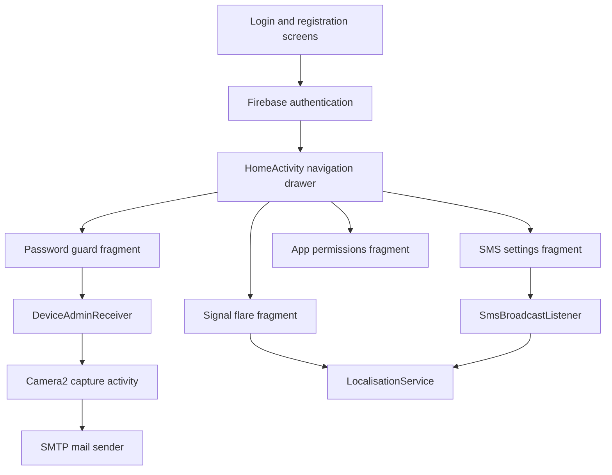

# Anti Theft Boomerang

A 2016 Android minor project for phone recovery workflows triggered by sign-in, password failures, SMS commands and battery status.

   

## Overview

Anti Theft Boomerang is an Android app built in Java with a navigation drawer, Firebase authentication and device recovery utilities. The code targets Android SDK 23 and uses the Android Gradle plugin 2.1.2.

The repository was created in 2016 and last pushed in 2018.

## Architecture



## Features

| Area | What the code does |
| --- | --- |
| Authentication | Supports email and password sign-in, Google sign-in and Facebook login through Firebase Auth. |
| Password guard | Uses a device administrator receiver to count failed unlock attempts and launch a camera capture flow after a configured threshold. |
| SMS control | Enables password-protected SMS commands for ringer mode, alarm playback and location lookup. |
| Signal flare | Stores a battery threshold and starts location reporting when battery level reaches it. |
| App permissions | Lists launchable installed apps, shows requested permissions and opens the system app settings page. |

## Tech stack

- Java Android app module.
- Android Support libraries and Design Support library.
- Firebase Auth, Realtime Database and Storage dependencies.
- Facebook Android SDK.
- JavaMail jars stored under `app/libs`.

## Project structure

```text
.
|-- app
|   |-- build.gradle
|   |-- google-services.json
|   |-- libs
|   |-- src/main/AndroidManifest.xml
|   |-- src/main/java/com/project/aditya/antitheftboomerang
|   |-- src/main/res/layout
|   |-- src/main/res/menu
|   |-- src/main/res/values
|-- build.gradle
|-- gradlew.bat
|-- settings.gradle
```

## Getting started

Prerequisites:

- Android Studio or an Android SDK command-line setup that can build SDK 23 projects.
- A JDK compatible with the Android Gradle plugin used by this project.
- A private Firebase project configuration for local testing.

Build from the repository root:

```bash
./gradlew assembleDebug          # Windows: gradlew.bat assembleDebug
```

Configuration notes:

- The current code reads Firebase and social sign-in settings from `app/google-services.json` and `app/src/main/res/values/strings.xml`.
- The current mail sender reads SMTP credentials from `Config.java`.
- Replace all service configuration with private local values before running a personal build.

## Credits

- This was a team minor project. The source headers and package name credit other team members alongside Rishabh Jain.
